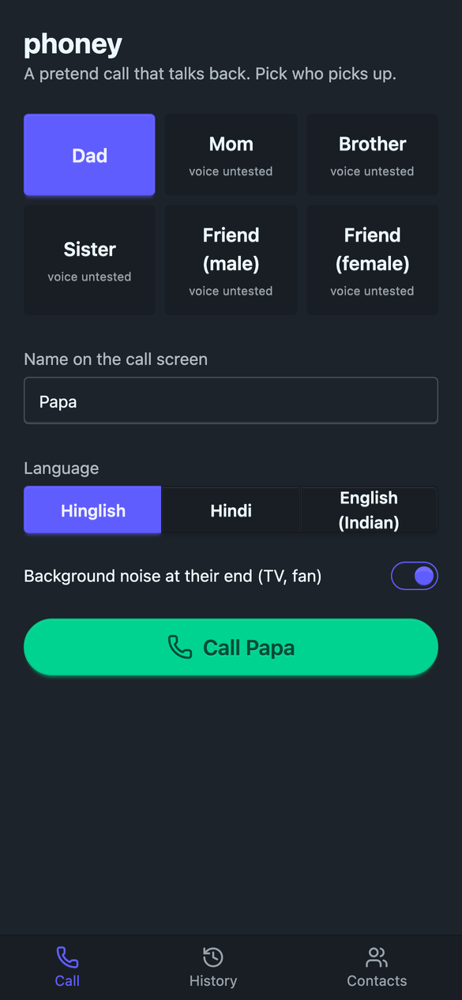
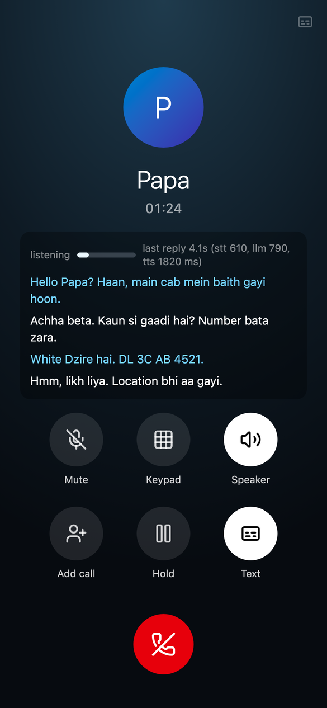
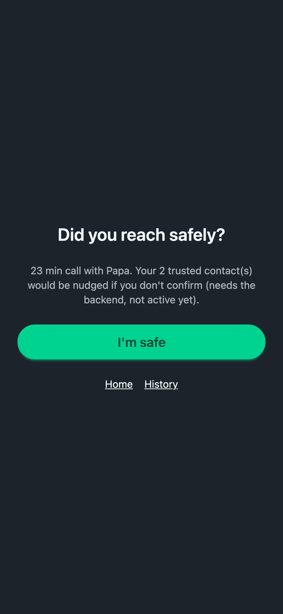
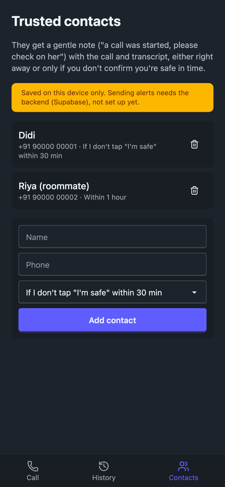

<!-- META RULE: cap this file at 150 lines. It is a working map for humans and
     agents, not a manual. If `wc -l README.md` exceeds 150, rephrase or truncate
     rather than append: tighten prose, delete what has stopped being true, or
     move a section into docs/ and link it from here. Check before every commit.
     Sibling docs carry their own caps. -->

# phoney (tentative name)

**▶ Listen to demo calls (real latency): <https://phoney-call.netlify.app/demos/>**

A fake phone call that talks back. In India many women call someone, or pretend to,
when walking alone or riding in a cab at night. phoney places a call to an AI "dad",
"mom", "brother" or "friend" who answers in a natural Indian voice (Hindi, English or
Hinglish), reacts like a real person, and keeps quiet when she just wants to scroll.

Free to use. React PWA + Netlify + Supabase + OpenRouter (one key for LLM, STT and TTS).
<p>   </p>

## The call

- Pick who answers: male/female, parent/sibling/friend. Language: Hindi, English,
  Hinglish, all with Indian accents (more languages later).
- The responder mostly responds. Sometimes it asks something useful, like a person would:
  "gaadi ka number bata zara" when she mentions a cab, "haan, location share aa gaya",
  "toh kitni der mein pahunch jaogi?". It is not nosy and is fine with long silences.
- Realism: phone-band audio, TV/fan in their room, natural pauses; bar: "a bystander believes it".

## Safety features (order to be decided)

- **Trusted contacts.** Notify them immediately or only after a delay. The delayed
  mode is for when she does not want to disturb anyone: like Google's inactive-account
  manager, data is released only if she does not tap **"I'm safe"** in time.
- **Gentle nudge.** If a session goes quiet, contacts get "a call was started, please
  check on her", with the call audio, transcript, and anything she mentioned (cab
  plate, route).
- **Location sharing**, later, if needed.
- **Records retained** for a possible investigation, even after "I'm safe".

Later: make call time useful (voice journal, a listener); export just her side of the transcript.

## Status

Live at <https://phoney-call.netlify.app> behind a shared password (ask Avi), with a working
call loop, server-side call logging, and the voice lab. No user accounts yet.

- **Call loop:** ringback -> responder picks up -> browser VAD -> STT `openai/gpt-4o-mini-transcribe`
  -> reply `google/gemini-3.5-flash-lite` (reasoning `minimal`), streamed -> TTS per clause as
  soon as it is complete -> phone-band filter with a TV room behind. A cached "हम्म / हाँ" plays
  if he hasn't started 2.5 s after she stops. Long silences ask the model, which usually stays
  quiet. Mic is ignored while the responder talks (no barge-in yet).
- **Turn detection (speculative):** at 300 ms of silence the app sends STT + reply + TTS; it plays
  only once the silence reaches 600 ms and drops it all if she resumes (mostly caught during STT).
- **Voice:** dad = `fish-audio/drama-3` cloned from an 8 s Algenib clip (`server/voices/` +
  transcript in `shared/personas.ts`), 44.1 kHz PCM, first byte ~0.35-0.5 s; falls back to Gemini
  Algenib on error or > 4 s. Others use Gemini TTS (~1.8 s floor). `PHONEY_TTS_ENGINE=gemini` forces it.
- **Latency** (her last word -> his first sound, median of 8 lab turns): **~2.3-2.5 s**, was
  ~4.3-4.4 s, local and deployed. Real browser calls: 1.9-2.9 s. See [docs/latency.md](docs/latency.md).
- **Cost:** a busy call is roughly $0.01/min all-in (Gemini voice $0.0136 per minute of him
  talking; Fish lists ~10x cheaper per character), a mostly-silent one far less.
- **Screens:** pick responder + language, a dialer-style call screen (hidden transcript
  with per-turn latency), "I'm safe" after the call, history, trusted contacts (stored
  locally; alerts need the backend).
- **Voice lab** (`sim/`): 34 voices across 9 TTS models auditioned; picks are Sulafat (her,
  for simulations) and Algenib (dad). Findings: [docs/voices.md](docs/voices.md).

Voices other than dad (mom, siblings, friends) are untested guesses in
`shared/personas.ts`. A PWA in the background (she switches apps to scroll) may lose
mic/audio, especially on iOS; may need a native wrapper later.

## Layout

```
src/            React app: pages/, lib/call.ts (call loop, speculative turns), api.ts (streamed
                reply -> per-clause TTS), audio.ts (phone chain, ringback, PCM playback),
                mic.ts (VAD -> WAV), store.ts (localStorage)
server/         API handlers as Request -> Response: api.ts (stt, reply as NDJSON stream, tts
                with fallback, log), voices/ (clone reference clips), log.ts (call logging),
                limits.ts (request caps), auth.ts (password gate), prompt.ts (system prompt)
netlify/        functions/api.ts (all of /api/*), edge-functions/gate.ts (password gate)
shared/         personas (voices, style), clauses.ts (reply splitter), API types
scripts/        smoke-call.ts (headless call with lab clips), logs.ts (inspect call logs),
                setup-supabase.ts (creates the log bucket)
sim/            voice lab: scenes.json, lab.py, orlib.py; out/ + ledger gitignored
docs/voices.md  TTS findings, scores, costs, latency
```

## Run

```bash
npm install
npm run dev                  # http://localhost:5173, /api/* served by vite.config.ts
npm run dev:phone            # HTTPS on the LAN so a phone can use the mic
node scripts/smoke-call.ts cab_night dad hinglish   # headless check (PHONEY_URL/PASSWORD: deployed)
uv run sim/lab.py all        # voice lab (needs ffmpeg); open sim/out/index.html
```

Needs `OPENROUTER_API_KEY` in `phoney/.env` or the shared `../.env` (server-side only).
Models are overridable with `PHONEY_LLM_MODEL`, `PHONEY_STT_MODEL`, `PHONEY_TTS_MODEL`.
The lab stops at `PHONEY_BUDGET_USD` (default $8); the app's calls are not budgeted.

## Call logs

Every call is logged server-side for debugging: per turn her WAV (as sent to STT), the
transcript, the reply, his TTS audio as WAV, timings (STT, LLM first clause, TTS first byte), models
and TTS engine (clone or Gemini fallback), and
errors; plus the client's start/end summaries (persona, language, user agent, per-turn
latency incl. VAD tail and her-end -> his-voice, silences, fillers). The client sends
`X-Phoney-Session` / `X-Phoney-Turn` headers and posts to `/api/log`; failures never break a call.

- **Dev:** `logs/calls/<session>/` (gitignored; session ids start with the date).
- **Deployed:** private Supabase Storage bucket `phoney-logs` (in the `mandarin` project for
  now; free tier is full), same layout, events as `events/*.json`. Also one `[log]` line per
  request in the Netlify function logs.
- `node scripts/logs.ts [latest|<id>]` shows a timeline; `--remote [<id>]` lists or
  downloads deployed sessions into `logs/calls/`.

## Deploy (Netlify)

`netlify deploy --build --prod` from `phoney/` (site `phoney-call`, already linked). The edge
function gates every path, `/api/*` included, with an HttpOnly cookie = HMAC of the password;
the function checks it again. Caps: Netlify per-IP rate limits (400 req/min site, 200/min
API) plus in-memory 150/min per IP and 2500 requests per call session.
Env vars (Netlify UI or API, never committed): `OPENROUTER_API_KEY`, `SUPABASE_URL`,
`SUPABASE_SERVICE_ROLE_KEY`, `PHONEY_PASSWORD` (spaces or hyphens between words both work),
`PHONEY_COOKIE_SECRET` (random hex; rotating either logs everyone out). Locally,
`phoney/.env` holds the Supabase pair for `logs.ts --remote` and `setup-supabase.ts`.

## Roadmap

- [x] Voice lab: provider audition, scripted calls, phone-call mix
- [x] Live loop: mic -> STT -> LLM -> TTS, latency shown per turn
- [x] PWA shell (Vite + React + Tailwind/daisyUI), dialer-style call screen
- [ ] Try it on a phone; tune VAD thresholds, prompt, filler frequency
- [x] Cut latency: streamed reply, per-clause Fish TTS, speculative turn detection (4.3 -> 2.3 s)
- [ ] Barge-in; re-measure latency from an Indian network
- [ ] Audition voices for mom / siblings / friends
- [x] Rate-limit /api, password gate, call logging (local + Supabase Storage)
- [ ] Supabase: auth, sessions, transcripts, trusted contacts (RLS)
- [ ] "I'm safe" timer + delayed notify (Netlify scheduled function)
- [x] Netlify deploy
- [ ] Own Supabase project for phoney (logs live in `mandarin`'s for now)

## Conventions

- Never commit secrets or generated audio; `sim/out/` and the ledger are gitignored.
- Lab paid calls go through `orlib` so they are logged and budget-checked.
- The OpenRouter key stays server-side (`server/`); the browser only calls `/api/*`.
- Before committing: `npm run build && npm run lint`, and `wc -l README.md` <= 150.
- Hindi text for TTS is written in Devanagari (better pronunciation); keep a roman
  transcript beside it for display.
