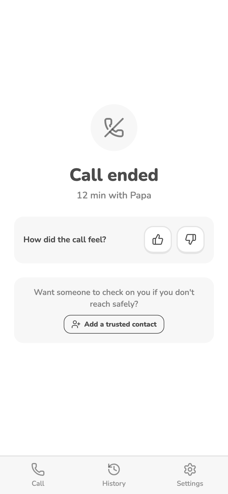
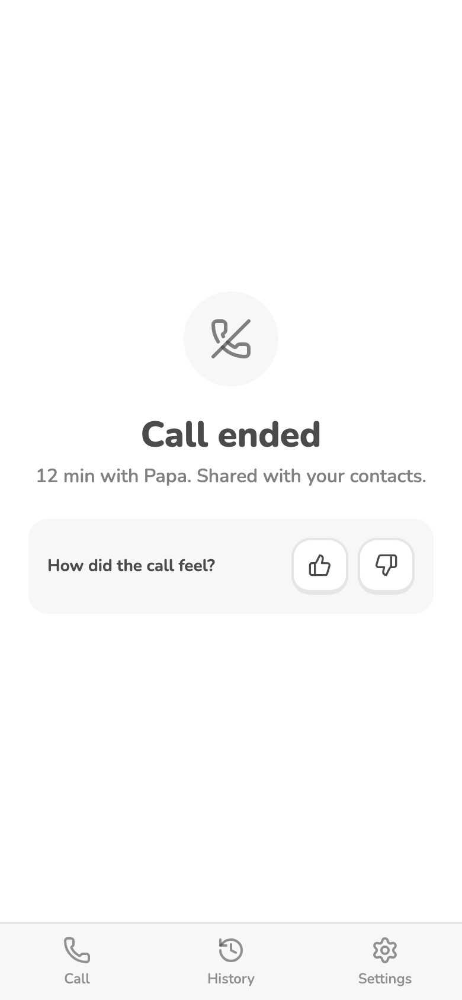
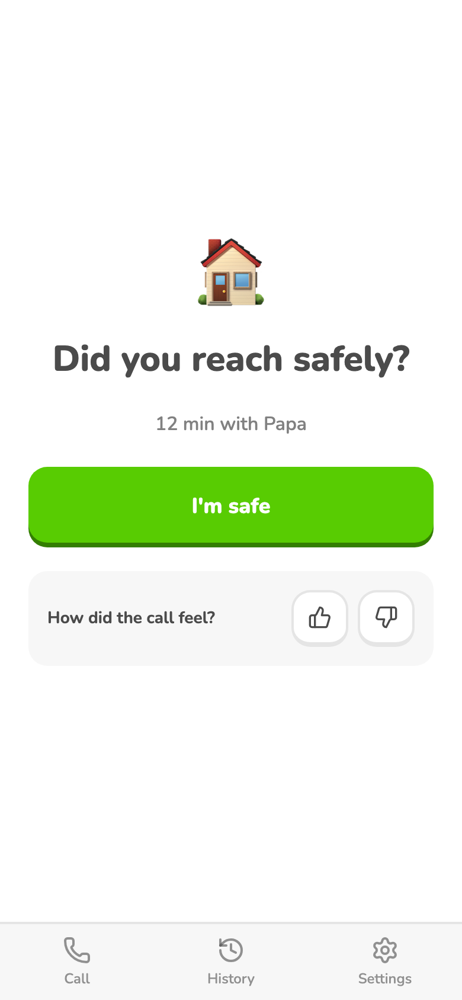

# After the call

When a call ends she lands on `/after/:id`. What she sees depends on her trusted contacts:

- **No contacts:** "Call ended", minutes with him, 👍/👎, and "Add a trusted contact".
- **Only right-away contacts** (delay 0): "Call ended … Shared with your contacts." No "I'm safe": they already saw the call, so tapping it would change nothing.
- **At least one delayed contact:** "Did you reach safely?" with **I'm safe**. Once tapped: "Your contacts won't see this call" (or "Contacts on a delay won't see this call" when some are right-away).

No Home or History links: the bottom tabs (Call, History, Settings) are always visible here.

## Screenshots

Web, local dev server, demo data (contacts saved on the phone, signed out), 2026-11-07.

## Where it lives

| | Web | Android |
|---|---|---|
| Screen / route | `/after/:id` (`src/pages/AfterCallPage.tsx`) | same |
| How she gets there | hang up | hang up |
| Differences | none: same build, installed on the Pixel 2026-11-07 (screen not yet eyeballed there) | |

Contact delays come from `phoney.contacts` on the phone plus, when signed in, `trusted_contacts.delay_min`.

## Tests

- `after-call-states` (manual or headless): seed `phoney.sessions` with one call and `phoney.contacts` with none / one at delay 0 / one at delay 30, open `/after/<id>`. Expect: add-contact prompt / "Shared with your contacts" and no I'm safe / I'm safe. Last run: 2026-11-07, web headless, 3/3.

## Notes

- 2026-11-07 Home button and Home/History links removed; "I'm safe" hidden when every contact is right-away; dropped "Alerts to contacts aren't live yet" (no copy about what isn't built).
