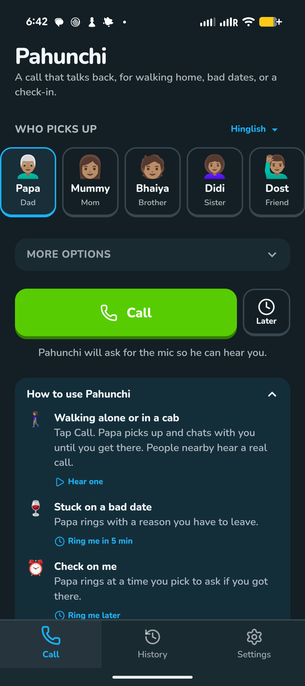

# Android app

The same React build (`dist/`) inside a Capacitor shell (`capacitor.config.ts`, `android/`). `/api/*` goes to the deployed site (`src/lib/native.ts`). Agents build the debug APK and install it on the user's Pixel 9a for every Android-facing change.



Pixel 9a, 2026-11-07, debug build of `efd722d` plus uncommitted work (package id `com.avijitthawani.pahunchi`).

## Build and install

```bash
npm run android                      # vite build + cap sync android
export JAVA_HOME=/opt/homebrew/opt/openjdk@21/libexec/openjdk.jdk/Contents/Home   # no system Java on this Mac
(cd android && ./gradlew -q assembleDebug)
adb -s <device> install -r android/app/build/outputs/apk/debug/app-debug.apk
adb -s <device> shell monkey -p com.avijitthawani.pahunchi -c android.intent.category.LAUNCHER 1
adb -s <device> exec-out screencap -p > /tmp/shot.png   # check it, show the user
```

## Connecting to the Pixel over Wi-Fi

macOS Local Network privacy blocks `adb` when Cursor starts it: `adb pair`/`adb connect` fail with "No route to host" or "protocol fault" even though `ping` and `nc -vz` reach the phone. Two ways out:

1. **Best:** the user allows Cursor in System Settings > Privacy & Security > Local Network; then plain `adb pair` / `adb connect` work.
2. **Relay (works today):** the system `nc` is allowed on the LAN, so relay adb through it.

Ask the user for: Developer options > Wireless debugging > **Pair device with pairing code** (6-digit code + IP:port, valid ~1 min with the dialog open), and the **IP address & Port** on the main Wireless debugging screen (a different port).

```bash
# pair once (pairing port), through a one-shot relay; local ports must be <= 65535
mkfifo /tmp/pix/f && (nc -l 127.0.0.1 47001 < /tmp/pix/f | nc <ip> <pair-port> > /tmp/pix/f &)
adb pair 127.0.0.1:47001 <code>
# connect (main port): run this loop as a long-lived background shell, else it dies with the command
while true; do rm -f /tmp/pix/c && mkfifo /tmp/pix/c; nc -l 127.0.0.1 47010 < /tmp/pix/c | nc <ip> <main-port> > /tmp/pix/c; done
adb connect 127.0.0.1:47010           # device shows as 127.0.0.1:47010, model Pixel_9a
```

- Run `adb` with full permissions; if the adb server was first started inside the sandbox it has no network, so `adb kill-server` first.
- Pairing survives; if Wi-Fi blips the main port changes, so only ask for the new IP:port and restart the loop.
- Origin of the trick: the `../sense` project chats.

## Notes

- 2026-11-07 Another chat changed the package id `com.avijitthawani.phoney` -> `com.avijitthawani.pahunchi` (uncommitted when this card was written), so the Pixel has both apps side by side; the old one can be uninstalled once the user agrees. The sign-in deep link (`AUTH_REDIRECT` in `src/lib/native.ts`) moved with it.
