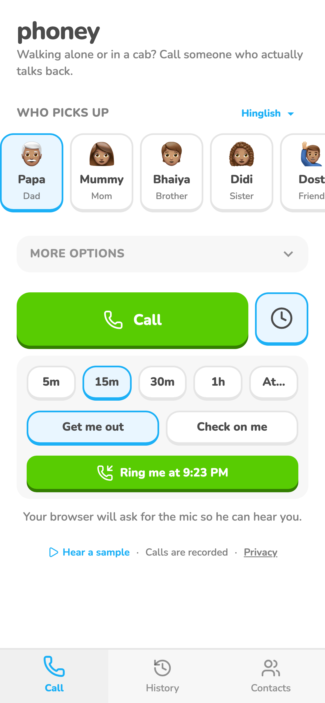
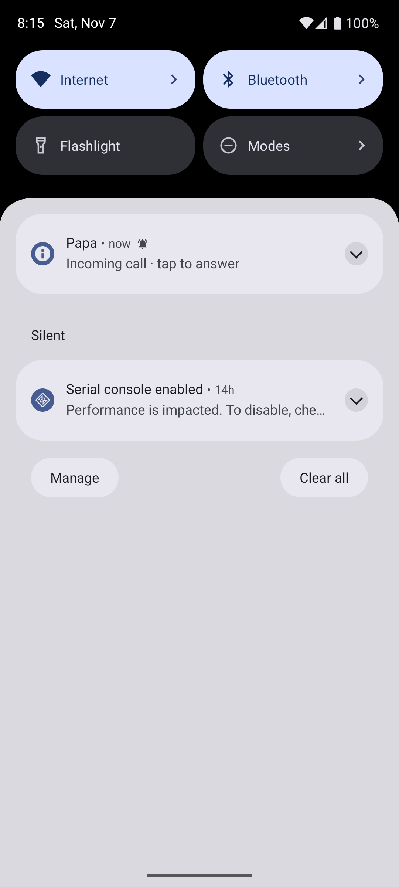
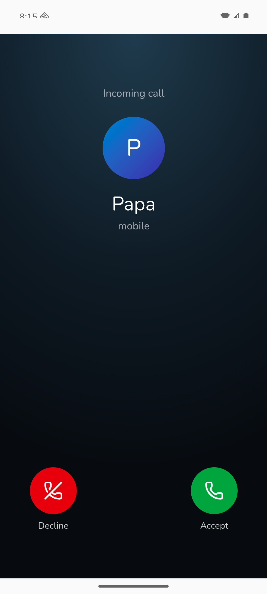

# Call me later

A clock button beside Call opens an inline panel: when (5m-1h or a time) and a two-way toggle, Get me out or
Check on me. At that time he rings her and speaks first.

## Screenshots

Left: web, demo data, 2026-11-05. Middle and right: Android emulator, 2026-11-07: the notification, then the incoming screen after tapping it.

## Where it lives

| | Web | Android |
|---|---|---|
| Screen / route | `/` (clock panel), `/incoming` | same |
| How she gets there | Home -> clock button | Home -> clock button |
| Differences | Web Push; iPhone needs Add to Home Screen | local notification (no Web Push in the WebView); plain notification, not a ringing screen; exact-alarm permission prompt unexplained; "app fully closed" untested |

## Tests

None yet. Emulator: a scheduled call rang on time and opened `/incoming`.

## Log

- 2026-11-07 card created. Android change is on the Pixel build but not committed.
