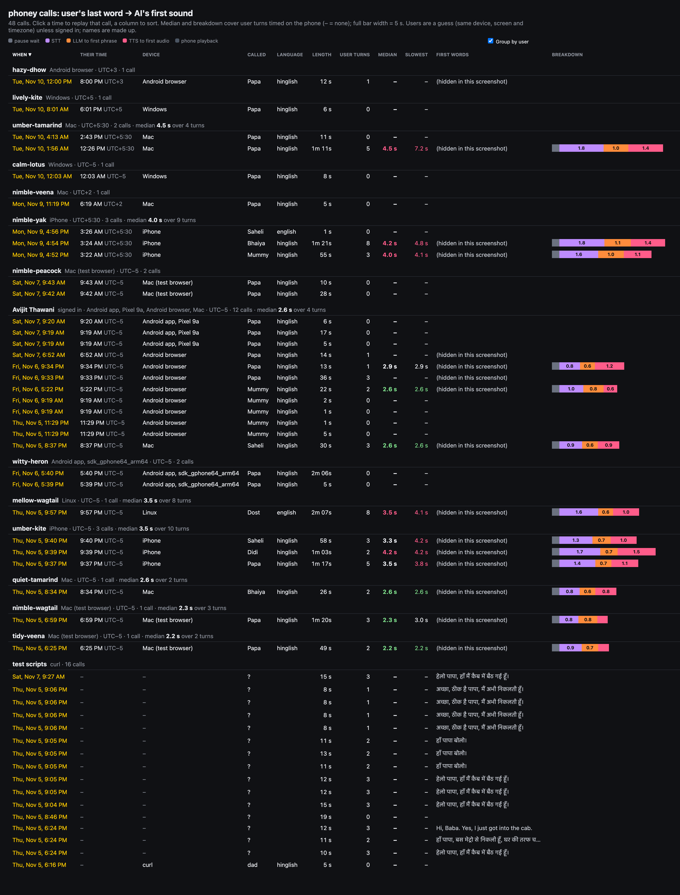
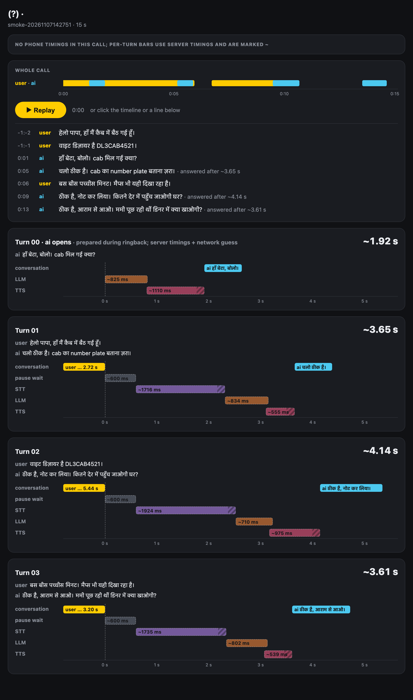
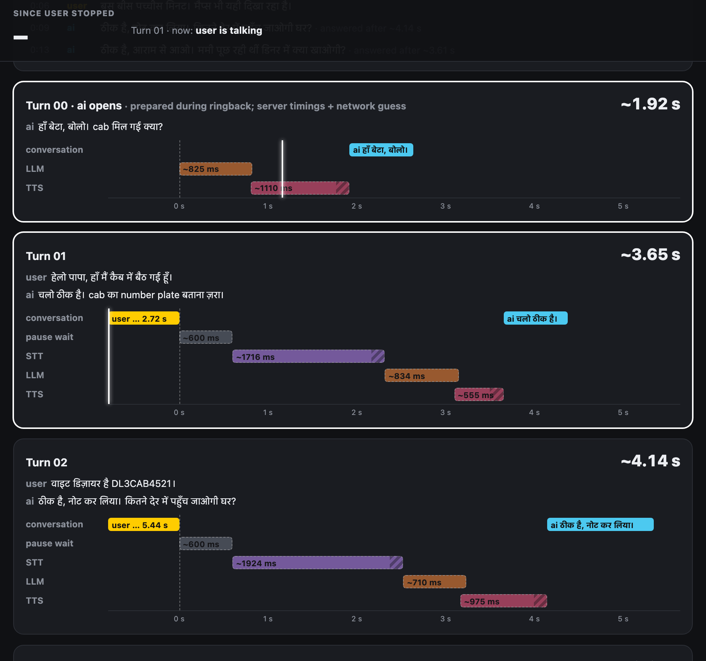

# Call replay

A local debugging page, not part of the app: it plays back any logged call on one timeline and, for every turn, splits "user's last word -> AI's first sound" into pause wait, STT, LLM and TTS. No shipping tag applies; it never deploys and has no Android side.

## Screenshots

Left: the index, 2026-11-10, with real callers' first words hidden for the screenshot. Middle and right: a scripted `smoke-call` with lab voices, so every bar is dashed and marked "~" (server timings plus a network guess); real calls show solid bars for the server's share and hatched for upload, network and decode. Real callers' pages are never committed.

## Where it lives

| File | What it does |
|---|---|
| `scripts/replay.ts` | builds `logs/replay/<id>.html` + `.json` from `logs/calls/<id>/`, the index, and `serve` on `localhost:5199` |
| `scripts/replay-index.html` | the index page: sorting, grouping, sticky header (data filled in by `replay.ts`) |
| `scripts/replay.html` | the page: Replay button, clickable timeline and transcript lines, per-turn panels |
| `scripts/replay-shot.mjs` | PNG of a call or the index, `--video` for an MP4 with the call audio (headless shell from `../scratch/ai-video`) |

Deployed calls must be downloaded first: `node scripts/logs.ts --remote` lists them, `--remote <id>` fetches one. Output stays in `logs/` (gitignored: voices and transcripts).

## How to read it

- Step lengths come from the phone's per-turn metrics, so they add up to the delay she heard. The STT bar therefore includes the upload; the solid part is the server's own time.
- Index: one row per call (when, the caller's own clock time, device, who she called, length, user turns, median and slowest delay, first words, per-step bar). Click a header to sort; blanks always sort last. Median covers user turns timed on the phone; "–" means none (test scripts, or she hung up before speaking).
- Users: a signed-in call takes the account's name (looked up through the `calls` table with the service key in `.env`, cached in `logs/replay/accounts.json`). Everyone else gets a made-up adjective-noun name per device + screen size + UTC offset, so two people with the same phone model in one timezone merge, and one person on two devices splits. The UTC offset comes from the session id, which starts with the caller's local time. "Group by user" can be switched off.
- The opening line and turns the call ended on have no phone metrics, so they use server timings and are marked "~".
- Fillers are placed from the phone's clock, corrected by the start event's skew.

## Tests

- `replay-serve`: `node scripts/replay.ts serve`, open `localhost:5199`, click a call, press Replay; audio plays in order and the playhead follows. Last run: 2026-11-10, 48 calls built, a call page returns 200; audio checked by ear on 2026-11-07 only.
- `replay-shot`: `node scripts/replay-shot.mjs <id>` and `index` write PNGs to `logs/replay/`. Last run: 2026-11-10, pass.

## Notes

- 2026-11-10 The logged `ip` can't tell callers apart: unrelated devices in different timezones share one address and one call's start and end differ, so it isn't used for grouping. Not investigated.
- 2026-11-10 A reply to each of two back-to-back user turns shows as two AI clips in a row (turns 09 and 10 of a tester's call); the page doesn't flag it, you have to spot it. Worth a marker when an AI clip starts before the next user turn's reply.
- 2026-11-10 `logs.ts --remote <id>` took about a minute per call for ten calls (one request per file); a bulk download would help.
- 2026-11-10 Today's calls from India: 4.0-4.5 s median against 2.2-2.6 s for the 2026-11-05 Mac calls; details on [the-call.md](the-call.md).
- 2026-11-07 Idea on [home-and-navigation.md](home-and-navigation.md): show this whole-call row in History.
