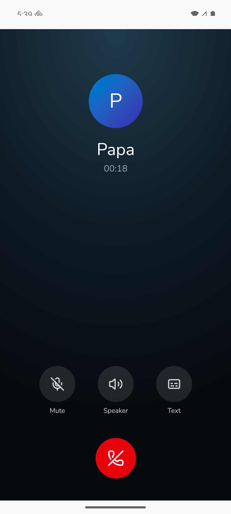
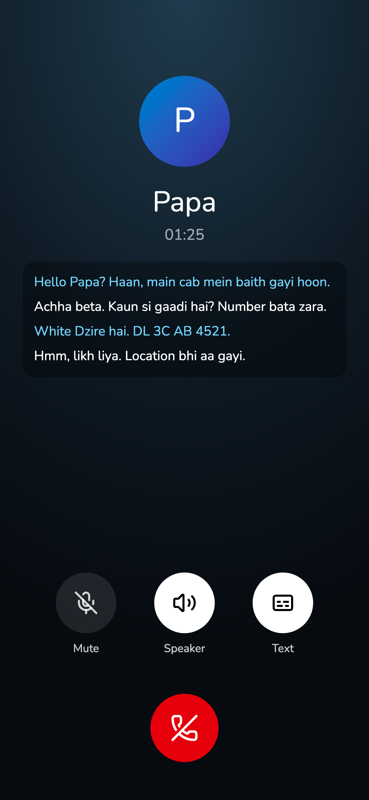

# Call screen

A dialer-style screen: name, timer, Mute, Speaker, transcript behind "Text", hang up. Nothing on it is fake. On Android it sounds like a phone call: earpiece by default, a Bluetooth or wired headset if one is connected, the loudspeaker only while Speaker is on.

## Screenshots

Left: Android emulator, 2026-11-06. Right: web, demo data, 2026-11-05. Same layout on both.

## Where it lives

| | Web | Android |
|---|---|---|
| Screen / route | `/call` | same |
| How she gets there | Starting any call | Starting any call |
| Differences | browsers can't pick the earpiece, so it plays on the loudspeaker; Speaker only changes volume | earpiece, Bluetooth/wired headset, real Speaker, proximity screen-off |

Code: `src/lib/route.ts` (no-op off Android), `android/.../AudioRoutePlugin.java` (picks the device with `setCommunicationDevice`, SCO before Android 12, re-applies when headsets come and go), `src/lib/call.ts` (on Android, opens the mic before the AudioContext so playback is voice-call audio, not media).

## Tests

Check routing without listening: `adb shell dumpsys audio | rg 'com.avijitthawani.phoney|uid: <Pahunchi uid>'` shows each `setCommunicationDevice` and the device type. Never leave Speaker on while testing.

- `earpiece-default` (Android): call with no headset; route is earpiece before the first sound. Last run: Pixel 9a, 2026-11-07 08:07, pass. The WebView picked the speaker when the mic opened; the plugin switched to earpiece 230 ms later, before playback started; playback was `USAGE_VOICE_COMMUNICATION`.
- `speaker-toggle` (Android): tap Speaker, route goes speaker; tap again, back to earpiece/headset. Last run: Pixel 9a, 2026-11-07 09:20, pass (user by hand; log shows earpiece 09:20:06, speaker :07, earpiece :08, speaker :09).
- `bluetooth-headset` (Android): connect earphones, call; route is Bluetooth; disconnect mid-call, falls back to earpiece. Not run (Pixel Bluetooth was off).
- `proximity-off` (Android): on earpiece, covering the sensor blanks the screen. Not run.

## Log

- 2026-11-07 Speaker verified; Bluetooth still untested. User okays prod with that gap; shipped to dev for now. `npm run build && npm run lint` on a clean `main` checkout: pass.

- 2026-11-07 Bug: after hangup the WebView re-sets the speaker as Pahunchi's call route (08:07:41 in the Pixel log) and it lingers until the app is killed. Nothing audible, since Android ignores it once the call is inactive, but `stop()` should clear it again after the WebView tears down.
- 2026-11-07 debug APK on the Pixel (built 08:12) includes `AudioRoutePlugin`. Routing commit `5f24baf` is also on `prod`; the web side is a no-op there.
- 2026-11-07 card created. Web/Android audio difference is a platform limit.
