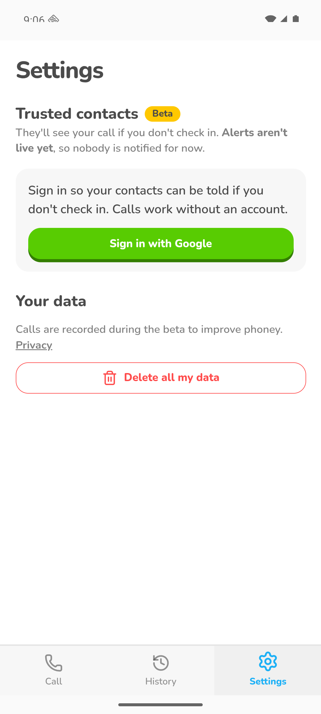
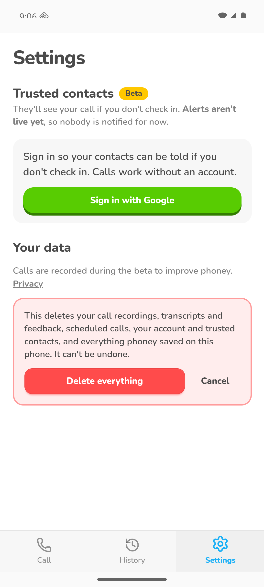

# Delete all my data

Settings -> Your data -> "Delete all my data" removes her call recordings, scheduled calls, account and
everything on the phone. All Pahunchi data lives in the phoney Supabase project.

## Screenshots

Android emulator, signed out, 2026-11-07: the Settings tab, then the confirmation after tapping the button (cancelled, nothing deleted). No web screenshot yet.

## Where it lives

| | Web | Android |
|---|---|---|
| Screen / route | `/settings` (Your data), `/privacy` | same |
| How she gets there | Settings tab | Settings tab |
| Differences | none | not checked on the Pixel |

## Tests

None yet. The recording-deletion step was run against the real bucket; the full button flow never end to end.

## Log

- 2026-11-07 card created. Live on prod; the Settings page itself is not committed yet. The deletion itself runs on the server (account function, recordings bucket); the button and clearing what's stored on the phone run on the device, so it keeps platform tags rather than `server`.
