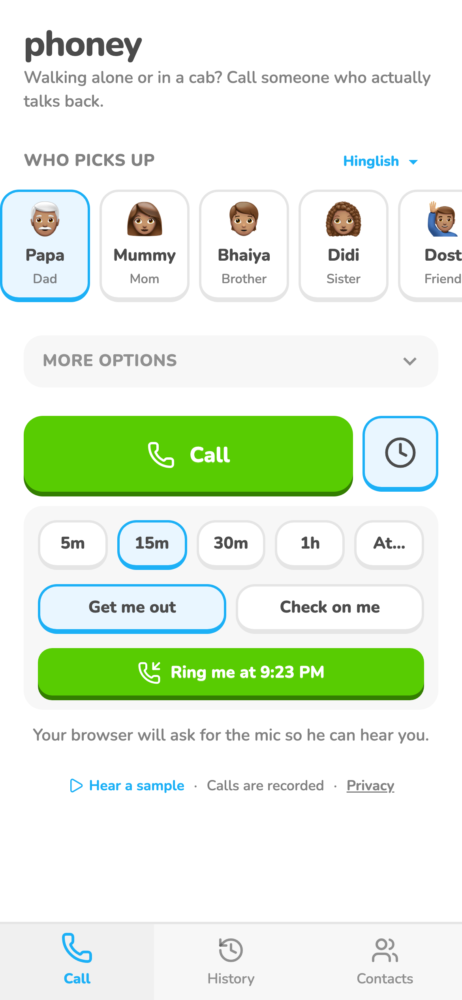
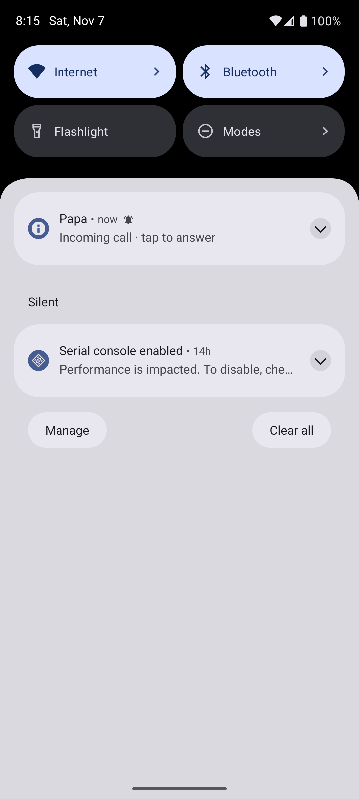
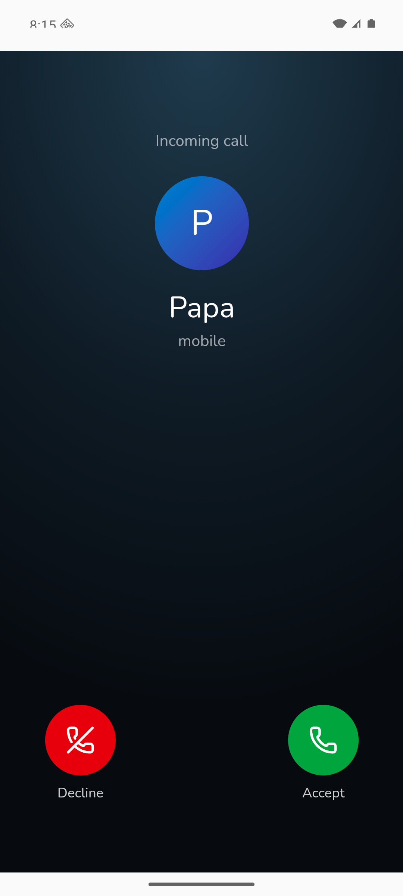

# Example card

One or two sentences on what she can do. Here: a clock button beside Call schedules a call; at that time he rings her and speaks first.

## Screenshots

Left: web, demo data, 2026-11-05. Middle and right: Android emulator, 2026-11-07. One shot per platform where they differ, a caption saying where and when each was taken, and what has changed in the app since. Images go in `kanban/media/<card>-<platform>-<what>.png`.

## Where it lives

| | Web | Android |
|---|---|---|
| Screen / route | `/` (clock panel), `/incoming` | same |
| How she gets there | Home -> clock button | Home -> clock button |
| Differences | rings by Web Push | rings by a local notification; plain, not a full ringing screen |

## Tests

- `schedule-and-ring` (web, Android): schedule 5m, Get me out; close phoney; it rings on time and he speaks first. Last run: emulator only, 2026-11-07.

## Notes

- Newest first, one line each: what changed, what's broken, what's next.
