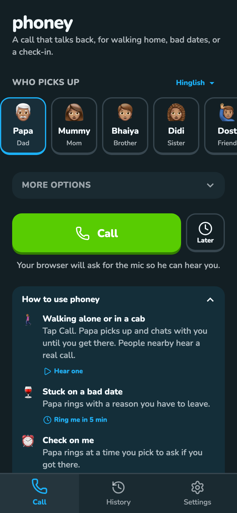
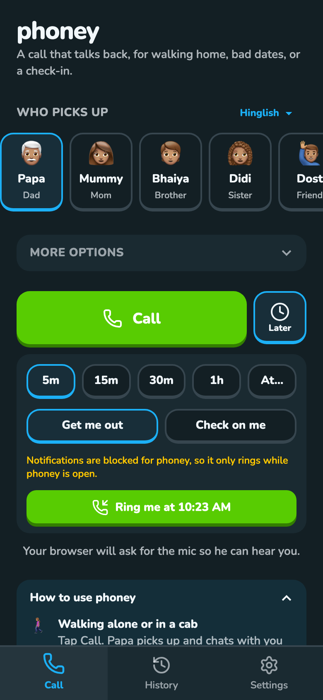
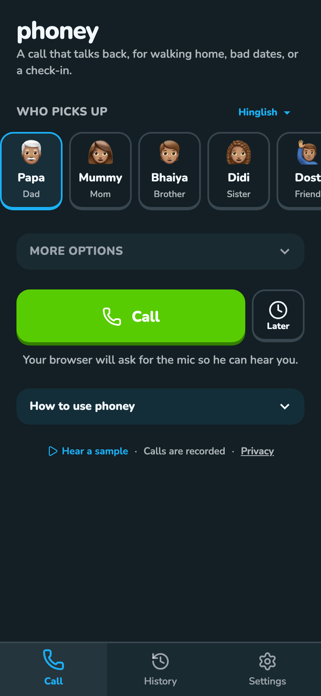
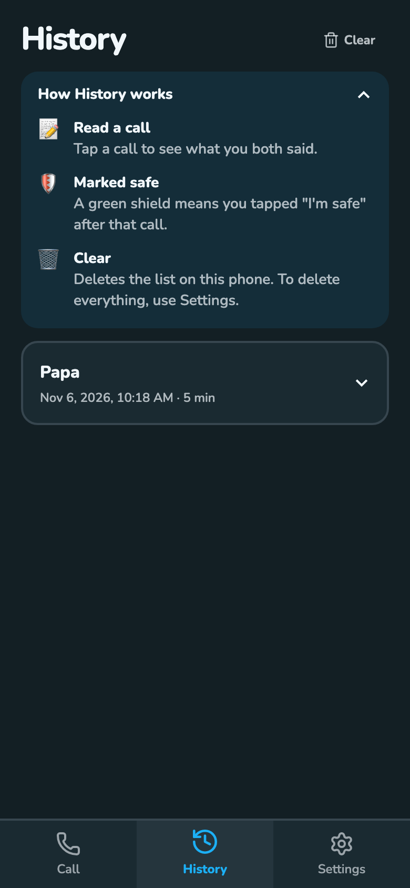
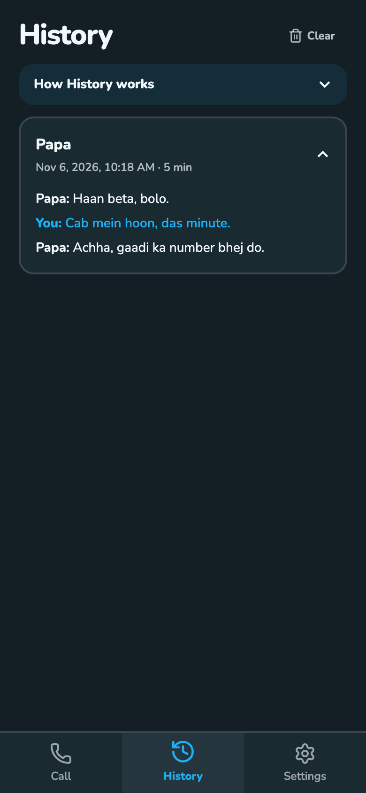
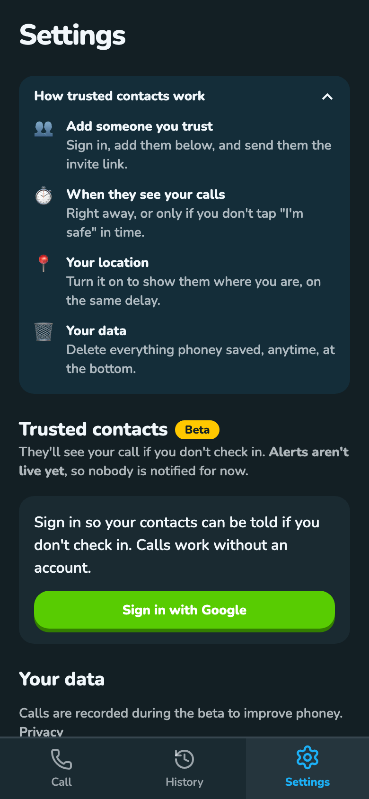

# First visit

A newcomer should see what phoney is for, including the uses that aren't obvious: getting out of a bad date ("Get me out") and a later check-in ("Check on me"). Each tab has its own "How to…" box. It starts open, folds itself once she reaches that tab's milestone, and stays one tap away after that.

## Screenshots

Web, localhost, 2026-11-07, uncommitted. Light mode: `media/first-visit-web-home-light.png`. The yellow notifications line is the headless browser blocking notifications.

## What each tab says, and when it folds

| Tab | Box | Folds when |
|---|---|---|
| Home | Walking alone or in a cab (▶ Hear one), Stuck on a bad date (Ring me in 5 min), Check on me (Ring me later), Someone to watch out (Add a trusted contact) | she has a call where she spoke at least once |
| History | Read a call, Marked safe, Clear | she opens a call |
| Settings | Add someone you trust, When they see your calls, Your location, Your data | she has a trusted contact (account or this phone) |

Also: the clock button reads "Later"; tagline "A call that talks back, for walking home, bad dates, or a check-in."; the Home box sits under the Call row so Call stays above the fold. The "Ring me" buttons open the Later panel preset and scroll to it. The fold is remembered per tab in `phoney.howto.<tab>`. This replaces the old one-time How it works card (`phoney.introSeen`, now unused).

Earlier pass: [UX review of phoney](9149ac6f-40c6-463b-b8dd-2cf6be13ea6e).

## Where it lives

| | Web | Android |
|---|---|---|
| Code | `src/pages/HowTo.tsx`, used by `HomePage.tsx`, `HistoryPage.tsx`, `SettingsPage.tsx`; `LaterPanel` `preset` in `CallLater.tsx` | same |
| How she gets there | each tab | same |
| Differences | none | none expected; not yet looked at on the Pixel |

## Tests

- `fresh-tabs` (web, Android): clear localStorage (Android: clear app data). All three boxes are open. "Ring me in 5 min" opens the Later panel on Get me out, 5m. Make a call and say something: Home's box is folded next time. Open a call in History: its box folds. Add a trusted contact: Settings' box folds. Last run: web screenshots via headless Chrome, 2026-11-07; Android not run.

## Log

- 2026-11-07 Per-tab how-to built on localhost (uncommitted), replacing the three Home chips the user found uninformative ("walk home isn't informative"). Not done: a recorded Get me out sample; Home has two sample players ("Hear one" and the footer "Hear a sample").
- 2026-11-07 card created: "get me out of bad date or check on me isn't obvious to people".
