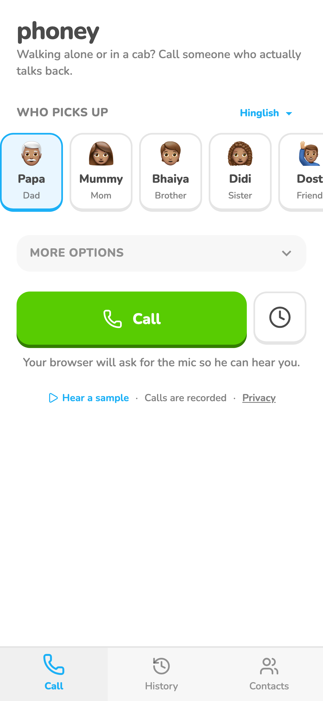
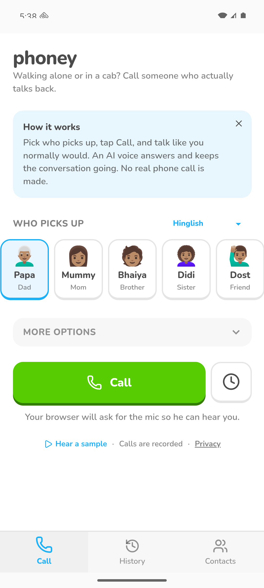

# Home and navigation

Home: who picks up, Call with the clock button beside it, and a collapsed More options. Three bottom tabs:
Home, History, Settings. On the web she can add Pahunchi plus a separate one-tap "Call" icon to her home screen.

## Screenshots

Left: web, demo data, 2026-11-05. Middle: Android emulator, 2026-11-06, with the How it works card. Right: the one-tap "Call" icon on the web. All still show the old Contacts tab.

## Where it lives

| | Web | Android |
|---|---|---|
| Screen / route | `/`, `/history`, `/settings`, `/go` | same tabs |
| How she gets there | site or installed PWA | app icon |
| Differences | install card and `/go` Call icon; in Android browsers the card offers the APK instead of Add to Home Screen | install card hidden in the app; long-press "Call now" shortcut status unchecked |

## Android app download (until the Play Store)

- The install card's "Pahunchi for Android" row (Android browsers only) links to `github.com/avijit-thawani/pahunchi/releases/latest/download/pahunchi.apk`, so each release must attach the APK under exactly that name.
- Package id `com.avijitthawani.pahunchi` (was `.phoney`; installs as a separate app). Sign-in needs `com.avijitthawani.pahunchi://auth` in Supabase Auth -> URL Configuration -> Redirect URLs.
- Release build: `npm run android && cd android && ./gradlew bundleRelease assembleRelease` (JDK 21). Signing reads the gitignored `android/keystore.properties`; without it the release build is unsigned. The upload key lives outside the repo on the user's laptop; losing it means no updates for sideloaded installs. Bump `versionCode` in `android/app/build.gradle` each release.

## Tests

None yet.

## Log

- 2026-11-07 First signed release (versionCode 1) launched on the emulator; Android download row checked on localhost with an Android user agent.
- 2026-11-07 Settings tab (trusted contacts + "Delete all my data") committed to `main`; `/contacts` redirects to `/settings`. Live prod already had it from the locked laptop deploy of 2026-11-06; dev had the old Contacts tab until now.
- 2026-11-07 card created.
