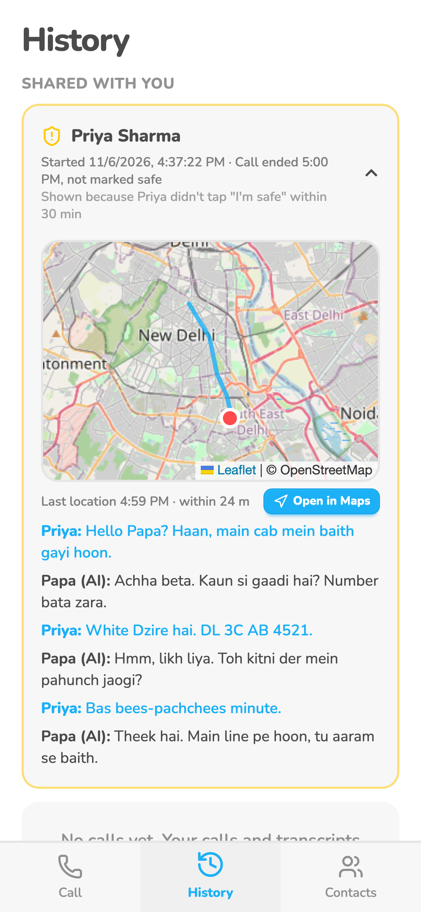
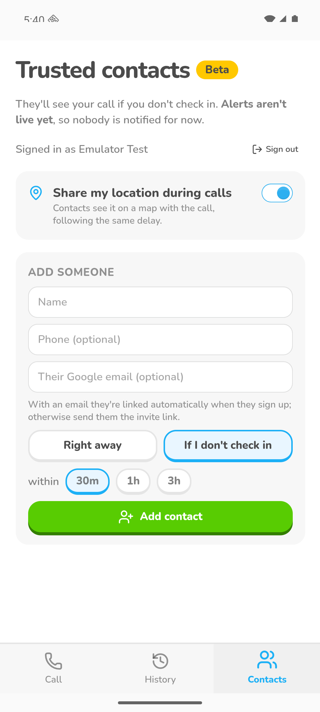
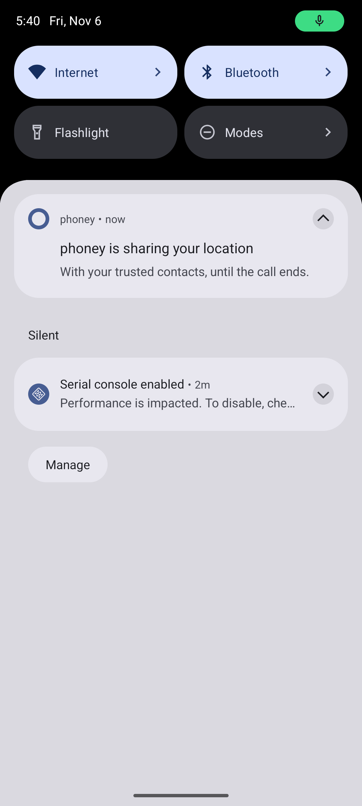
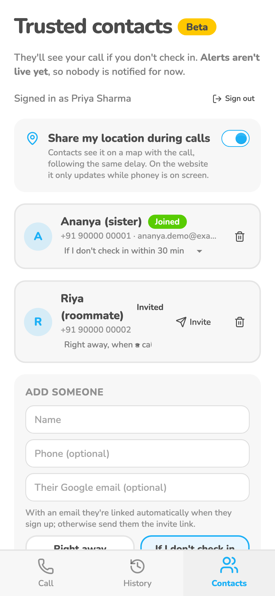

# Location sharing

An opt-in "Share my location during calls" toggle. Contacts see a map with her trail, last position and
"Open in Maps", under the same delay rule as calls. Sharing stops at hang-up.

## Screenshots

1: what a contact sees in History (web, demo data, 2026-11-06). 2-3: Android emulator, 2026-11-06, toggle and the background notification. 4: the web toggle (demo data, 2026-11-06). All taken before the Contacts tab became Settings. None yet show the per-point dots.

## Where it lives

| | Web | Android |
|---|---|---|
| Screen / route | toggle in `/settings`; map in the contact's `/history` (`src/pages/CallMap.tsx`) | same |
| How she gets there | Settings tab, only after Google sign-in (toggle is hidden when signed out) | same |
| Differences | records only while phoney is on screen; never tested on a real browser; user's try failed | keeps going in the background with a notification |

## How it records (`src/lib/location.ts`)

- Android watcher: `stale: true` (last-known fix, used if under 5 min old, stamped with its real time) and `distanceFilter: 0`. Android's displacement filter withheld every fix while the phone was still; JS keeps a point only every 10 s, or sooner if she moved more than max(20 m, the fix's accuracy).
- First point uploads immediately; until one upload succeeds, retries every 3 s (the call row can land ~4 s late, and the foreign key rejects points before it). After that, every 15 s plus a flush at hang-up.
- Map: dashed line between points (route between them unknown), small blue dot per point with its time on tap, red dot plus accuracy circle for the last. Tiles from OpenStreetMap via Leaflet.

## Tests

Pixel 9a, 2026-11-07, account avijit.thawani@gmail.com, contact sidavijit: before the fix a 12 s call stored 0 points (API logs showed no `call_locations` request). With `distanceFilter: 20` the Pixel got 0 fixes in 20 s sitting still; with 0, first fresh fix at 15.1 s, last-known at 0.0 s. After the fix: 18 s call 4 points, 22 s call 4 points 7-10 s apart, 12 s call first upload 3.8 s after start. The user saw the trail and last point on the contact's map.

Still wanted: a web test (signed in, toggle on, browser allows location, call, contact sees the trail).

## Log

- 2026-11-07 Android fixed and verified on the Pixel (above); map shows a dot per point.
- 2026-11-07 user's web try failed: it treated sharing as app-only. Code does have a web path
  (`navigator.geolocation` in `src/lib/location.ts`), so the cause is unknown: possibly the signed-in-only toggle,
  the browser permission, or copy. For the next agent to reproduce and fix.
- 2026-11-07 card created.
