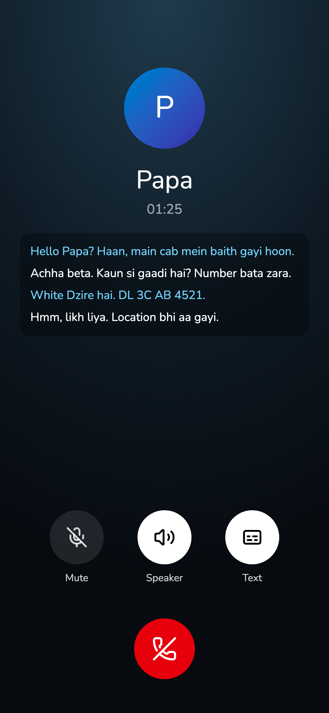
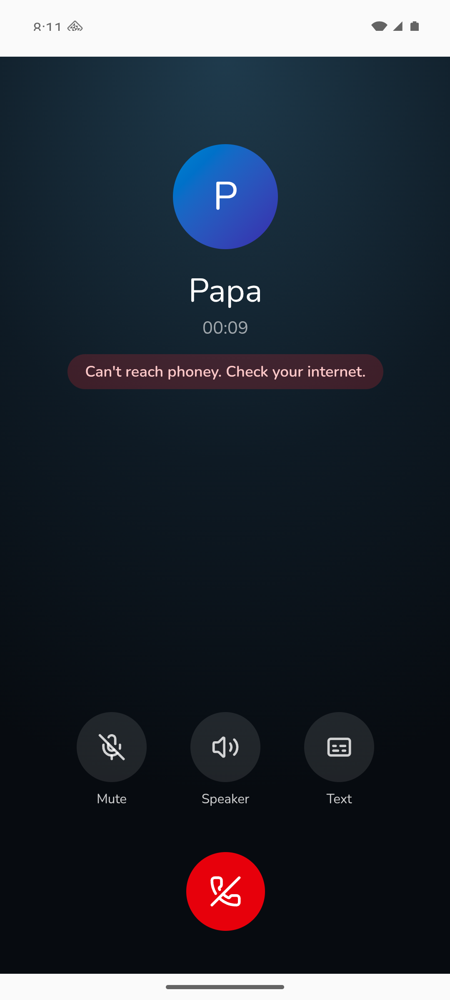

# The call

She taps Call, hears ringback, and a relative picks up and talks with her in Hindi, English or Hinglish,
with phone-band audio and a TV in the room behind him.

## Screenshots

Left: web, demo data, 2026-11-05. Right: Android emulator, 2026-11-07, the "Can't reach Pahunchi" error (not on prod yet).

## Where it lives

| | Web | Android |
|---|---|---|
| Screen / route | `/call` | same, inside the app |
| How she gets there | Home -> Call, or the "Call" home-screen icon (`/go`) | Home -> Call |
| Differences | none known | mic keeps running in the background; not yet tested on the Pixel for > 5 min |

## Tests

- `smoke-call` (web): `node scripts/smoke-call.ts cab_night dad hinglish` completes with replies; `PHONEY_HER=sarvam:aparna_hi_customer` voices her lines in the sister's Sarvam voice instead of the lab's Gemini clips. `smoke-call short` uses her real one- to three-word lines. Passes when he opens and replies with audio; latency is logged, not a gate. Last run: dev, 2026-11-07, pass. Short lines: median 2.6 s (2.6-3.2 s), STT 1.0-1.3 s, and he stayed silent after "हम्म" and "ठीक है". Long lab lines (2-6 s): medians 3.5-4.0 s. Server-side STT (Sarvam `saaras:v4`) took 1.6-1.8 s per turn, against 0.5-1.2 s for Scribe in `docs/latency.md`. LLM first clause 0.5-0.8 s and TTS first byte 0.4-1.1 s are on target.

## Log

- 2026-11-07 latency regressed to ~3.5-4 s on dev, almost all from Sarvam STT (switched from Scribe in `d4d6f4a` for Hindi accuracy). Its transcripts also write English lines in Devanagari ("आई जस्ट गॉट इनटू द कैब") and heard "White Dzire" as "वाइट साइडर" once. Real calls 2026-11-05/06 (20 replied turns): median her end -> his voice 3.5 s (2.6-4.2 s); lines under 1.3 s: median 3.4 s, with STT ~1 s, LLM first clause ~0.6 s and TTS first byte 1.0-1.2 s (slower than smoke-call's 0.4-1.1 s).
- 2026-11-07 card created. Deployed to prod by hand before the dev/prod split, so no tests ran; plain-words errors not deployed yet. STT, reply and voice run on the server (Android gets those changes with each site deploy); mic, turn detection and playback run on the device.
