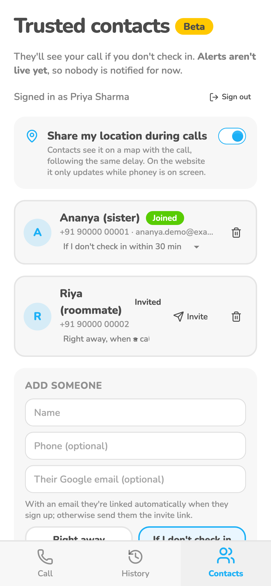
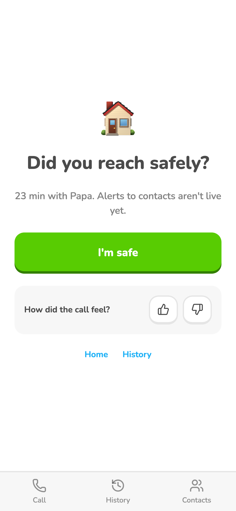
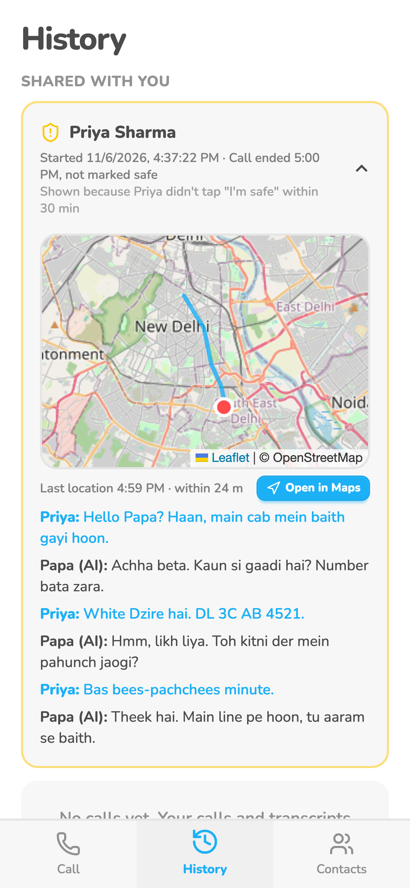

# Trusted contacts

She signs in with Google and invites people by link or email. Each contact sees her calls (audio, transcript)
in their History right away, or only if she doesn't tap "I'm safe" in time. No push or email alerts yet.

## Screenshots

Web, demo data, 2026-11-05/06. Contacts now live in the Settings tab; no screenshot of that page yet.

## Where it lives

| | Web | Android |
|---|---|---|
| Screen / route | `/settings` (contacts), `/history`, `/join/:token`, `/after/:id` | same |
| How she gets there | Settings tab; invite link | Settings tab |
| Differences | none | invite links open in the browser, not the app; native sign-in only half tested |

## Tests

- `contacts-e2e` (server, so web and Android alike): `node scripts/contacts-e2e.ts` makes two throwaway accounts without Google and checks add contact, invite link, accept, Joined, shared call at "Right away", hidden at 30 min, no direct access to her calls, then "Delete all my data" for both. Last run: 2026-11-07, 11/11 pass, nothing left behind.
- Google sign-in itself and the Settings/History screens need a person: sign in on dev with two Google accounts.

## Log

- 2026-11-07 Removed the Beta badge and "Alerts aren't live yet". Settings now says "They can see your calls in Pahunchi, right away or only if you don't tap "I'm safe" in time." The invite message said "so you can be told if I need help", which nobody is; it now says "so you can see my calls there".

- 2026-11-07 "I'm safe" now shows only when at least one contact is on a delay; details on [after-call.md](after-call.md).
- 2026-11-07 card created. Settings rename is live on prod but not committed yet.
