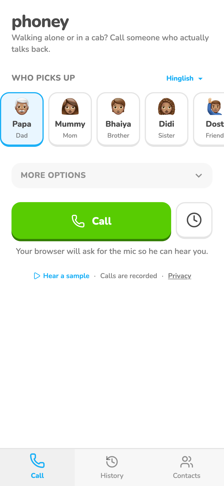
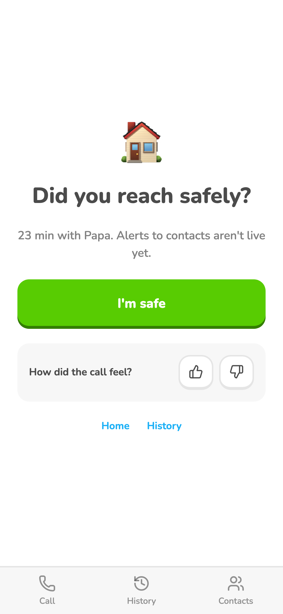

# Who picks up

She picks Dad, Mom, Brother, Sister or a male/female friend (shown as Papa, Mummy, Bhaiya, Didi, Dost, Saheli). Sister (Didi) is the default for Call now, scheduled calls and the call-now shortcut (`DEFAULT_PERSONA`); people who already picked someone keep their choice. Names stay the same when the language is English, since each card shows the role too. Each has two Sarvam voices, one picked at random per call and logged; after the call she can leave an optional 👍/👎 and note.

Voices, prompts and fallbacks are chosen on the server (`shared/personas.ts`, `server/api.ts`), so the Android app gets any change as soon as the site deploys. The picker on Home and the feedback after a call are the same screens on both.

## Screenshots

Web, demo data, 2026-11-05. The third tab has since been renamed from Contacts to Settings.

## Tests

None yet.

## Log

- 2026-11-09 default changed from Dad to Sister on `main` (dev).

- 2026-11-07 card created. Deployed to prod by hand before the dev/prod split, so no tests ran.
